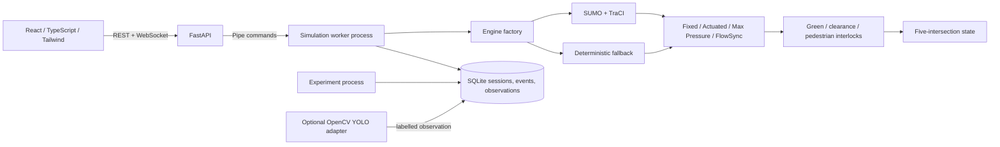

# Architecture

## Runtime

The project is a modular monolith. The FastAPI process validates requests and publishes snapshots; `SimulationWorker` owns the simulation in a separate spawned Python process and serializes commands over a pipe. The worker chooses SUMO/TraCI or the deterministic fallback through `simulation.factory`. SUMO itself runs as a child of the worker through TraCI. Experiments use a separate process pool so a long comparison does not block the API event loop.

## Modules

- `flowsync.models`: configuration, vehicles, incidents, intersections and state snapshots.
- `flowsync.simulation.sumo`: generates a five-signal network and seeded explicit vehicle/person trips, runs TraCI, reads queues and adapts the generated SUMO signal program.
- `flowsync.simulation.engine`: deterministic point-queue fallback with separate random streams for arrivals, route choice and service behavior.
- `flowsync.control`: controller phase requests and pressure calculation. Controllers cannot write signal state.
- `flowsync.safety`: independent fallback interlock for minimum green, yellow, all-red, walk and pedestrian-clearance intervals.
- `flowsync.api.worker`: process-isolated state owner and command channel.
- `flowsync.api.app`: REST, WebSocket, session history, observation intake and asynchronous comparative experiment endpoints.
- `flowsync.experiments`: scenario matrix, paired seed results, statistical summaries and SQLite report persistence.
- `flowsync.perception`: optional OpenCV DNN detector interface, YOLO ONNX adapter, video reader and stationary-queue estimator.
- `frontend`: responsive control room; values and vehicle indicators are sourced from API snapshots.

## Network model

The generated SUMO topology has five signalized intersections (`J0` through `J4`) along the middle row of a connected three-row, five-column grid. Two-way roads connect each row, with north/south approach roads and west/east corridor boundaries. SUMO plain node and edge XML is emitted before `netconvert` creates the signal links and crossing geometry. This is a generated SUMO network, not a surveyed or calibrated OpenStreetMap import.

The SUMO configuration enables a 0.7 m sublane resolution on 3.5 m lanes. Vehicle widths, lengths, speeds, acceleration and deterministic per-vehicle speed factors vary by motorcycle, car, auto-rickshaw, bus, heavy vehicle and emergency class. This permits lateral overlap/overtaking behavior within one lane in the SUMO model; calibration against local trajectories is still required.

## Data and configuration

SQLite stores simulation manifests, status, controller and incident/emergency events, periodic metrics, labelled observations and experiment run configs/results. `FLOWSYNC_EXPERIMENT_DB` selects the file. JSON structured logs use `FLOWSYNC_LOG_LEVEL`. Seeds, vehicle composition, demand, controller and engine are carried in each run manifest.

## Decisions and boundaries

- SUMO is primary when its executable, network generator and TraCI module are all available. `auto` uses fallback only when SUMO is unavailable; `sumo` requires SUMO explicitly.
- No GPU, video model weights, PyTorch or database server is required for non-video local runs.
- Each intersection uses its local Max Pressure controller when its simulated communication link is down.
- Signal-phase changes are controller recommendations filtered by the independent fallback safety interlock. SUMO uses its generated safe phase sequence and TraCI only adjusts the active phase's remaining green duration.
- There is no public infrastructure connector, command, credential or live signal output.
