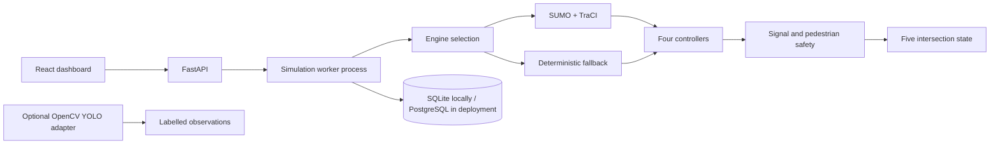

# FlowSync AI

**FlowSync AI — Incident-Aware Decentralised Intelligent Traffic Management System** is a research simulator for coordinating traffic across connected urban intersections. It was developed for the **Seva First Innovation Challenge 2026**, in the Infrastructure and Mobility sector, around the challenge of automating traffic management for India's heterogeneous road traffic.

The project models five connected intersections carrying motorcycles, cars, auto-rickshaws, buses, heavy vehicles, emergency vehicles and pedestrians. It lets researchers compare conventional and adaptive signal strategies under changing demand, incidents, emergency calls and communication failures. Its purpose is to make those comparisons reproducible and inspectable—not to operate real traffic signals.

## The research question

Can incident-aware, decentralized coordination improve network-wide traffic efficiency and resilience compared with conventional signal controllers?

FlowSync AI treats this as a hypothesis to test. It does not claim that its controller is already better. Each controller can be compared against the same seeded traffic demand and scenario, with measured delay, queues, throughput, emergency and pedestrian waiting, incident recovery and controller runtime. Results depend on the simulation engine, configuration, scenario and seeds; exploratory results are not evidence of real-world performance.

## How the system works

1. A seeded scenario creates traffic and pedestrian demand for a five-intersection network.
2. A controller chooses a signal phase at each intersection. FlowSync agents use local state and adjacent-intersection information when communication is available.
3. Incidents, emergency requests, pedestrian calls and communication loss can affect decisions during a run.
4. The safety layer constrains signal transitions. SUMO runs the microscopic traffic model when available; a deterministic point-queue simulator provides a lightweight alternative.
5. The API streams simulation state to the dashboard and stores run metadata and measurements. The experiment runner compares controllers using repeated, paired seeds.

The optional computer-vision path processes supplied video using OpenCV and a YOLO-compatible ONNX model. Video-derived observations are labelled separately from simulated state. No model weights, camera feed or real traffic observations are bundled with this repository.

## Controllers

| Controller | Decision basis |
|---|---|
| Fixed time | Alternates phase groups on a fixed schedule. |
| Actuated | Favors the phase group with greater local queue demand. |
| Max Pressure | Favors the phase with greater upstream pressure after accounting for downstream queues. |
| FlowSync | Extends pressure-based decisions with incident, emergency and pedestrian context and adjacent-node state; uses local Max Pressure as the communication-failure fallback. |

The controller implementations and their mathematical formulation are described in [TRAFFIC_CONTROL_ALGORITHMS.md](TRAFFIC_CONTROL_ALGORITHMS.md). The fallback simulator has an independent signal interlock for minimum green, yellow, all-red and pedestrian walk/clearance stages. SUMO uses its generated signal program and still requires runtime validation for the target scenario.

## What works now

- Five signalized SUMO intersections on a generated connected grid, bidirectional roads, sidewalks and crossings, mixed motorcycles, cars, auto-rickshaws, buses, trucks, and emergency types. The SUMO network enables a sublane mobility model for within-lane movement. Scenario demand is generated from a seed before control begins, so controller runs share the same vehicle and pedestrian departure traces.
- A TraCI engine that reads live queues and signal programs, runs fixed-time, actuated, Max Pressure and FlowSync decisions, and lets SUMO's generated signal program apply yellow/all-red clearance. SUMO is selected automatically when `sumo`, `netconvert` and Python TraCI are present.
- A deterministic lightweight fallback for environments without SUMO. Its outputs are model results, not observed traffic statistics.
- Minimum-green, yellow, all-red, dedicated all-red pedestrian walk and pedestrian-clearance interlocks in the fallback. Emergency requests influence phase choice and wait for ordinary safe transitions; they never force a conflicting green.
- An optional FastAPI service with a separate simulation worker process, WebSocket state stream, incident and emergency controls, and SQLite/PostgreSQL manifests/events/metrics/observation storage.
- A React/TypeScript/Tailwind operations dashboard with live network state, incident controls, emergency requests, controller selection and comparative charts.
- A paired experiment runner for nine scenarios, repeated seeds, per-class metrics, paired FlowSync-minus-baseline differences, Student-t confidence intervals, persisted records and JSON/CSV reports.
- An optional OpenCV DNN YOLO ONNX adapter and queue estimator. It requires actual model weights and labels; it does not invent detections.

These are implemented capabilities, not a claim that every deployment or research scenario has been validated. See [PROJECT_STATUS.md](PROJECT_STATUS.md) and [LIMITATIONS.md](LIMITATIONS.md) for the current verification record and known gaps.

## Install and run

Python 3.11+, SUMO with `sumo` and `netconvert` on `PATH`, and Python TraCI are recommended. For a fallback-only install:

```sh
python -m venv .venv
. .venv/bin/activate
python -m pip install -e '.[dev,api]'
flowsync --seconds 600 --seed 7 --controller flowsync --engine fallback
pytest
```

For the SUMO runtime, install the operating-system SUMO package and Python bindings that match its version. The following installs the optional bindings at the version reported by the local SUMO executable:

```sh
python -m pip install -e '.[sumo]'
SUMO_VERSION="$(sumo --version | sed -n '1s/.*sumo \([0-9.]*\).*/\1/p')"
python -m pip install "traci==${SUMO_VERSION}" "sumolib==${SUMO_VERSION}"
```

Then `flowsync --engine auto ...` uses SUMO when all runtime components are found; otherwise it explicitly reports and uses the fallback. To require SUMO, use `--engine sumo`, which fails with a clear missing-dependency error instead of silently falling back.

Start the API and dashboard in separate terminals. In the API terminal:

```sh
cp .env.example .env
set -a && . ./.env && set +a
uvicorn flowsync.api.app:app --host 127.0.0.1 --port 8001
```

In the frontend terminal:

```sh
cp frontend/.env.example frontend/.env.local
cd frontend && npm install && npm run dev
```

Open `http://localhost:5173`; API documentation is at `http://127.0.0.1:8001/docs`. The dashboard controls a real simulation state stream, not static sample values. API runs live in a separate worker process. The default SQLite file is `.flowsync/experiments.sqlite3`; override it with `FLOWSYNC_EXPERIMENT_DB`. Set `DATABASE_URL` to use PostgreSQL instead. Render deployment can use an externally managed Neon database.

Or run the container setup with `docker compose up --build`; it installs SUMO and exposes the dashboard at port 5173 and API at port 8001.

## Reproducible comparison

```sh
flowsync --experiment --scenarios normal-traffic peak-hour emergency-movement \
  --seeds 11 23 37 41 53 --seconds 1800 --export results.json
```

The command stores each run's seed, controller, scenario, configuration and metrics in the configured database. Reports include mean, standard deviation, confidence interval, per-class metrics and paired FlowSync-minus-baseline differences. Small exploratory runs are not evidence for the proposed research targets; run the full scenario and seed matrix using SUMO before making performance claims.

The experiment runner includes low, normal, peak, asymmetric, road-blockage, emergency-movement, multiple-incident, communication-failure and pedestrian-heavy scenarios. See [EXPERIMENT_METHODOLOGY.md](EXPERIMENT_METHODOLOGY.md) for metric definitions, pairing and recommended study procedure.

## Architecture



## Documentation

- [Architecture](ARCHITECTURE.md)
- [Development status and roadmap](DEVELOPMENT.md)
- [API reference](API_DOCUMENTATION.md)
- [Control algorithms and constraints](TRAFFIC_CONTROL_ALGORITHMS.md)
- [Experiment methodology](EXPERIMENT_METHODOLOGY.md)
- [Installation](INSTALLATION.md)
- [Deployment](DEPLOYMENT.md)
- [Limitations and validation status](LIMITATIONS.md)
- [Task register](TASKS.md)
- [Project status](PROJECT_STATUS.md)

## Deploy the demo

The repository includes a split deployment setup: the React/Vite dashboard runs on Vercel and the FastAPI/SUMO service runs on Render. Follow [DEPLOYMENT.md](DEPLOYMENT.md) to configure the GitHub-backed projects, `VITE_API_URL`, CORS origins and Neon `DATABASE_URL`. Local development continues to use SQLite unless `DATABASE_URL` is set. The API is not authenticated and is intended for a controlled research/demo environment.

## Scope and safety

FlowSync AI is a simulation and research platform. It does not connect to public traffic infrastructure, issue commands to real signals or provide a deployment path for controlling roads. Its generated traffic and the fallback engine are models; neither should be described as observed field data. The network, driver behavior, demand mix and controller weights are not calibrated against a representative Indian traffic dataset yet. See [LIMITATIONS.md](LIMITATIONS.md) before interpreting results.

## Screenshots

No screenshot artifact is committed. The dashboard is implemented and renders live data when the API is running; do not treat a screenshot or fallback run as empirical evidence.
